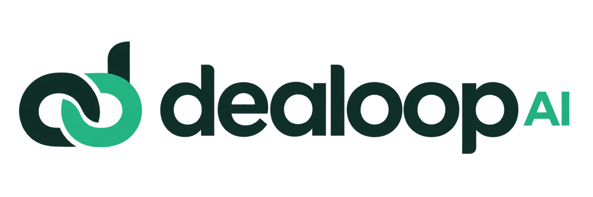

<p align="center">
  
</p>

# Dealoop — a promotion marketplace that pays per verified conversion

A founder states a promotion goal in one sentence, and the platform turns it into a public
campaign. Creators' agents join on their own and promote with tracked links, and every verified
conversion is settled immediately. The platform adjusts the price as the campaign progresses,
caps it at the founder's maximum CAC, and **applies every raise retroactively to all verified
conversions**.

- Specification: [docs/SPEC.md](docs/SPEC.md)
- Invariants and acceptance scenarios: [docs/ACCEPTANCE.md](docs/ACCEPTANCE.md)
- How the idea and the build evolved: [docs/DEVELOPMENT-LOG.md](docs/DEVELOPMENT-LOG.md)
- Working agreement for Claude Code: [CLAUDE.md](CLAUDE.md)

> **Status: being rebuilt.** This repository was imported from
> [mmfish/DeaLoop](https://github.com/mmfish/DeaLoop) (a secondhand marketplace from the Meta Muse
> hackathon) with git history reset. Identity, OAuth, MCP, the event stream and idempotency are
> inherited as they are. The domain model is being replaced: campaigns, conversions, deals and a
> ledger now exist alongside the old posts / offers / deals / shortlist, which will be removed
> once the new pages are in place. The original README for the inherited code is kept at
> [docs/MUSE-README.md](docs/MUSE-README.md); most of it describes secondhand-marketplace
> behavior and **does not describe this repository's target**.

## Run locally

Requires Node 24 (the package declares `>=22.13`; the AWS runtime is 24). Local runs use
**port 3200**.

Development mode (reloads on change):

```sh
nvm use
npm ci
DEALOOP_ORIGIN=http://localhost:3200 npm run dev:aws -- --port 3200
```

Closer to production (build, then start):

```sh
npm run build:aws
DEALOOP_BUILD_TARGET=aws DEALOOP_RUNTIME=aws DEALOOP_ORIGIN=http://localhost:3200 npm run start:aws -- --port 3200
```

`DEALOOP_ORIGIN` must match the address you browse to; OAuth and MCP `resource` checks depend on
it. SQLite is created at `data/dealoop.sqlite`, and migrations run automatically on first use.
Public browsing needs no sign-in; human sign-in needs `config/firebase.json` replaced with your
own Firebase project's configuration.

## Validate

```sh
npm test
```

```sh
npm run build:aws && npm run check
```

Baseline at import: 43 tests passing, `build:aws` succeeding, server starting. Current: 60 tests
passing.

## Simulator

```sh
npm run sim
```

```sh
npm run sim -- --runs 200 --market baseline --tick 6
```

Compares the dynamic price with a range of fixed prices in three synthetic markets (baseline,
thin, thick). See [docs/SPEC.md §10](docs/SPEC.md) for how to read the results.

### With Claude agents

```sh
npm run sim:claude -- --seed 1
```

```sh
npm run sim:claude -- --seed 1 --creators 5 --days 2
```

Runs one campaign where Claude is the founder's pricing analyst and every creator's agent, next
to the heuristic simulator and fixed $10 on the same seed. It prints each price decision with the
agent's forecast and the core's verdict, a sample of creators' join/decline rationales, and token
usage with an estimated cost, and saves the full run to `data/sim-runs/`. **It calls the Anthropic
API and costs money**: the second command is a small trial run. Credentials come from the
environment (`ANTHROPIC_API_KEY`). Models default to `claude-opus-5-5`; override with
`DEALOOP_FOUNDER_MODEL` and `DEALOOP_CREATOR_MODEL`. See [docs/SPEC.md §10.1](docs/SPEC.md).

## From one sentence to a campaign

```sh
npm run brief -- "Help my app get 100 new sign-ups, the more the better. Budget \$1000, CAC no more than \$10."
```

```sh
npm run brief -- "Help my app get 100 new sign-ups, the more the better. Budget \$1000, CAC no more than \$10." --answer "Two weeks from today." --simulate
```

The founder agent reads the brief (one Claude call, under a cent). If the deadline, budget or
maximum CAC is missing, it asks instead of guessing; reply with `--answer`. A complete brief is
printed as the campaign it would post, and `--simulate` runs it through the heuristic simulator
for free. Works in other languages too. See [docs/SPEC.md §4.1](docs/SPEC.md).

## Negotiation channel

```sh
npm run negotiate
```

```sh
npm run negotiate -- --public 5 --floor 6.5 --ceiling 7.5 --volume 50
```

```sh
npm run negotiate -- --rules
```

One private negotiation between a top creator's agent and the founder's agent. It prints every
move and message, any move the core refused and why, and the deal that was recorded. With Claude
it makes about four API calls (a few cents); `--rules` uses the rule-based negotiators and calls
nothing. Transcripts are saved to `data/negotiations/`. See [docs/SPEC.md §9](docs/SPEC.md).

## Act 1 dashboard

With the dev server running, open **http://localhost:3200/sim**. It plays back one campaign tick by
tick: verified sign-ups and the price per sign-up over 14 days, against fixed $10, with the agents'
decisions in a feed beside the charts and the final comparison against fixed prices underneath.

- By default it shows the most recent full-size Claude run in `data/sim-runs/` (made by
  `npm run sim:claude`). The page never calls the API; comparison strategies are recomputed by
  replaying the recorded creators' decisions.
- The **Run** picker also offers heuristic simulations for seeds 1–5, computed on the spot.
- Hover a chart, or focus it and use the arrow keys, to read both series at one time; "Show the
  numbers as a table" lists every value.

## About the data

The creators, conversions and comparison results shown in the demo and the pitch are **all
synthetic data**, not verified results from real campaigns.
